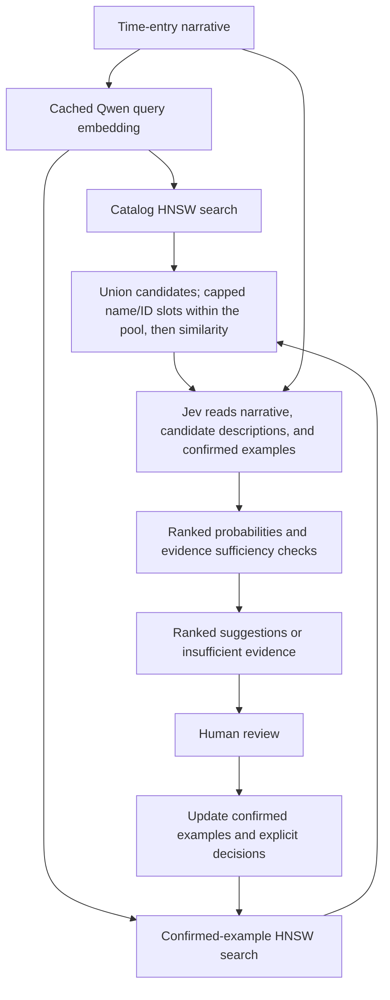

# PointTwo classification design

## Problem statement

PointTwo suggests the correct client–matter assignment for an existing time entry using its work narrative and a searchable client/matter catalog. **This is a multi-class classification problem:** each class is a client–matter pair. Embedding similarity retrieves plausible matters and confirmed examples; a Jev decision model reads their text together to judge the assignment.

For example, “Drafted term sheet for Series A round” should retrieve “Venture Financing – Series A” despite different wording. If several clients have equally plausible financing matters, the system should surface the ambiguity rather than invent a client identity.

This document covers the selected retrieval-plus-decision design, the evolution from weighted scoring, and the alternatives considered. The review application supports the Jev pipeline after explicit cloud opt-in; the four-feature weighted method remains a fully local baseline. Experimental confidence gates require further calibration before production use. See the [README](README.md#application-architecture) for the application architecture and setup.

## Requirements and design response

| Requirement | How the design addresses it |
| --- | --- |
| **Matching:** connect narrative paraphrases to relevant matters | Qwen embeddings capture semantic similarity; retrieved matters whose client name or matter ID appears in the narrative get capped shortlist slots. Jev interprets the original narrative, shortlisted matter descriptions, and confirmed examples together. |
| **Scale:** search 50,000+ client/matter records | Persist catalog and confirmed-example vectors in separate pgvector HNSW indexes. Retrieve bounded candidate sets before exact rescoring, rather than compare every record for every query. |
| **Reusable preparation:** store preparation and rebuild when data changes | Persist embeddings, text/model cache keys, indexes, source revisions, and preparation jobs. Reuse unchanged vectors; update changed records and support an explicit rebuild. Refreshing suggestions is separate from recomputing embeddings. |
| **Feedback:** accept or reject each suggestion and improve over time | Index accepted narratives as confirmed examples; corrections replace their associations and rejections exclude the applicable candidate. Future queries retrieve the corrected examples into the decision context. Hosted Jev is not retrained on these decisions. |
| **Low confidence:** signal weak matches | Include an insufficient-evidence option and a separate support question; apply validated probability/margin gates before marking a suggestion ready. Keep uncertain entries unresolved. Model probabilities require domain calibration. |

These are design mechanisms, not claims of measured accuracy. The [evaluation report](docs/EVALUATION_REPORT.md) separates matching quality, confidence coverage, feedback effects, and 50,000+ record search measurements, including limitations and unmet targets.

## Inputs and outputs

| Record | Fields |
| --- | --- |
| Time entry | `UserId`, `EntryId`, `Narrative`, `Hours`, `ClientName`, `MatterName`, `EntryDate` |
| Client/matter catalog | `ClientId`, `ClientName`, `MatterId`, `MatterName`, `MatterDescription`, `PracticeArea`, `MatterType`, `Status`; optional `RelatedKeywords` and `InvolvedTimekeepers` |
| Classification suggestion | `ClientName`, `MatterName`, `Score`, `Rationale`; return up to five ranked suggestions, with review status tracked separately |

Keep the **imported assignment**, **generated suggestions**, and **approved assignment** separate. Imported client/matter names may be wrong and are not training labels. Only confirmed assignments supply positive examples. `UserId` identifies the timekeeper; it does not grant access to a workspace.

Persist review decisions, source revisions, prepared embeddings, retrieval/model/prompt/policy versions, and immutable classification runs alongside the input records. These support audit history, stale-result detection, and reproducible debugging.

## Design evolution

| Stage | Decision method | Motivation and limitation |
| --- | --- | --- |
| Weighted baseline | Add catalog similarity, confirmed-example similarity, client-name match, and matter-reference match with fixed seeded weights | Fast and exactly explainable, but compresses text into four numbers and treats evidence additively. |
| Learned linear scorer | Fit those weights with logistic regression on reviewed entry/candidate pairs | Improves weighting, but still cannot recover distinctions absent from the features. Retained as a baseline experiment. |
| **Jev decision pipeline** | Read the narrative, candidate descriptions, and confirmed examples together | Selected application pipeline: interpret relationships and conflicting evidence directly. Additional inference, privacy, and calibration costs must be measured. |

The motivation is to preserve distinctions lost when text becomes a few numeric features. In the paired evaluation, “Revised financial covenants in the credit facility for Alder Robotics” scored slightly closer to Series A financing (cosine **0.6561**) than Credit facility (**0.6520**). The weighted baseline followed that order; Jev selected Credit facility from the supplied descriptions. In that November 17 run, held-out top-one accuracy improved from **87.9% to 95.0%**, but Jev also cleared one unsupported assignment. See the [paired results and worked examples](docs/EVALUATION_REPORT.md#jev-versus-similarity-and-weighted-scoring-november-17-shortlist). This synthetic result motivates further evaluation, not a claim that text reasoning always wins.

On November 22 the shortlist moved to capped exact-match slots, and the corpus gained 36 same-matter-name cases. On the expanded held-out set, Jev scored **93.8%** top-one versus **87.0%** for the weighted scorer on the same shortlist, and every expected matter reached the shortlist. See [Shortlist with capped exact client and matter matches](docs/EVALUATION_REPORT.md#shortlist-with-capped-exact-client-and-matter-matches). Those results also searched the whole catalog for named clients and matter IDs; that search was later removed, so the pool now comes only from indexed retrieval. Rerun without it, Jev scored **93.5%** and the weighted scorer **87.0%**. See [Pool without a full-catalog name search](docs/EVALUATION_REPORT.md#pool-without-a-full-catalog-name-search).

We retain Qwen and HNSW for efficient retrieval. Jev replaces the final weighted decision stage; it is not the embedding model or a search index. Example availability and catalog timekeeper involvement remain excluded as standalone bonuses.

## Classification flow



1. Retrieve up to 50 catalog neighbors and 100 confirmed-example neighbors, scoped to compatible workspace, model, source revisions, and timekeeper history.
2. Union their client–matter labels with matters this timekeeper previously accepted or rejected for the same narrative. Remove rejected candidates; honor applicable explicit approvals.
3. Select a **10-matter shortlist** in this order: an accepted matter; up to **3** matters whose matter ID appears in the narrative; up to **7** matters whose client name appears; then the highest maximum of catalog and confirmed-example similarity. Each group is ordered by similarity with stable ID tie-breaking. The caps keep a counterparty, a client with many matters, or a common-word matter ID from taking every slot. This selection does not use the weighted scorer or expected evaluation labels. Measure its recall before fixing its size.
4. Supply the original narrative, each candidate's client/matter names and catalog description, and up to three distinct confirmed narratives. Exclude the query's own normalized narrative. Do not send imported assignments, baseline scores, or evaluation labels as evidence.
5. Ask Jev to choose among the candidates and **insufficient evidence**, and separately assess whether the evidence uniquely identifies a matter. Rank matter options by their returned probabilities, then apply review rules and explicit decisions.
6. Return up to five suggestions for human review. Record the candidate set, prompt/model version, responses, and review policy so the result can be inspected and reproduced.

The two stages have different budgets: indexed retrieval searches the full 50,000+ record collection, potentially spanning thousands of client–matter classes; the decision model reads only **10 shortlisted matters and at most 30 confirmed examples**. There is no Jev call per catalog record. Track correct-matter coverage before and after shortlisting: an apparently certain decision among ten options can still miss an omitted alternative. The quality study uses 108 matters; larger-catalog decision quality remains to be evaluated.

**Without confirmed examples, retrieve and judge catalog descriptions alone.** Continue catalog search as history grows so new matters remain discoverable. Jev cannot recover the correct matter if retrieval or shortlisting omitted it.

Client names and matter IDs are **not searched for** across the catalog. Each retrieved candidate is flagged when its client name or matter ID appears in the narrative as a whole word, ignoring case, and step 3 uses those flags.

**Why capped exact matches.** Similarity alone misses two kinds of explicit reference:

- **Matter IDs:** catalog text omits matter IDs, so a narrative citing `file PT-03-03` cannot be matched to its matter by similarity. A similarity-only shortlist lost 21 of 96 such references.
- **Client names in large catalogs:** with 1,000 clients sharing matter names, similarity omitted the expected matter for 23 of 480 explicitly named clients. One correct matter ranked 421st, behind other clients with similar names.

Capped slots fixed both on the measured sets. The caps limit the old exact-first risks: named clients get at most seven slots, so a counterparty or a client with many matters cannot take every slot. Exact matching does not help misspelled or shortened names; Jev and similarity must handle those.

**Why the slots apply only within the pool.** Those measurements also searched every matter's client name and ID across the whole catalog. That search could not use an index, so it read every catalog row per query, and it stopped at 1,000 matches in arbitrary ID order. It was removed: the pool now comes only from indexed searches. The cost is that a named matter ranked below 50th by similarity is no longer found. Measured: held-out shortlist coverage fell from 100% to 99.6% (one matter-ID case, which Jev flagged as insufficient evidence), and Jev top-one from 93.8% to 93.5%. At 9,000 matters, 473 of 480 named-client queries reached the shortlist versus 480; a 200-matter pool reaches 479. See [Pool without a full-catalog name search](docs/EVALUATION_REPORT.md#pool-without-a-full-catalog-name-search). See [the worked example](CLASSIFICATION_EXAMPLE.md) and [evaluation report](docs/EVALUATION_REPORT.md#shortlist-with-capped-exact-client-and-matter-matches).

## Embedding preparation

| Source | Embedded text |
| --- | --- |
| Catalog | `ClientName MatterName MatterDescription RelatedKeywords PracticeArea MatterType`, joined with spaces |
| New narrative | The query instruction below followed by the narrative |
| Confirmed example | Narrative as a document, without the query instruction |

```text
Instruct: Retrieve the client and matter matching this work description.
Query: <Narrative>
```

Keep IDs, hours, dates, status, and `InvolvedTimekeepers` as structured metadata. Catalog timekeeper involvement does not affect ranking: a person may bill to many matters. `UserId` still scopes retrieval of confirmed narratives and explicit decisions. Validate finite, nonzero 1,024-dimensional vectors and store float32 values in Postgres. Query/document formatting produces distinct cache entries.

Cache by model/preprocessing identity and exact input text. Persist vectors, source revisions, and indexes so unchanged data is not prepared again. This satisfies reusable dataset preparation; reranking open entries after feedback is a separate freshness operation and does not require rebuilding all embeddings. Version model weights, runtime, pooling, instructions, dimensions, and precision; never mix incompatible embedding spaces.

## Decision model and review

### Jev input and output

The initial experiment uses TypeSafe’s hosted **`jev-1.14.0`**, pinned rather than a moving alias. Its Choice API returns a distribution over supplied options. A companion Noul question checks whether the evidence supports a unique assignment. These questions are evaluated independently; the support question receives the same candidate evidence, not the Choice answer. [Choice](https://docs.typesafe.ai/primitives/choice), [Noul](https://docs.typesafe.ai/primitives/noul).

| Input | Purpose |
| --- | --- |
| Original narrative | Preserve relationships, negation, transaction context, and named entities |
| Candidate names, identifiers, status, and catalog descriptions | Define the actual client–matter choices |
| Retrieved confirmed narratives, associated with each candidate | Show similar work previously assigned by a reviewer |
| Fixed instructions and insufficient-evidence option | Require evidence for identity; allow unsupported and ambiguous inputs to remain unresolved |

Use opaque option keys mapped to stable client/matter IDs. Shuffle their presentation deterministically to avoid exposing the baseline ranking. Treat imported record text as untrusted evidence, never as instructions. Validate returned option IDs, finite probabilities, their sum, answer types, and model identity. A timeout or malformed response is a processing failure, not a successful classification or silent fallback.

For this pipeline, `Score` is the returned matter-option probability, conditional on the supplied shortlist and prompt. It is **not interchangeable with the baseline's weighted score** or automatically calibrated for legal work. Preserve the insufficient-evidence probability rather than renormalizing it away. `Rationale` should describe retrieved supporting evidence and review reasons, not claim access to Jev’s internal reasoning. The debugger shows option probabilities, supplied texts, and before/after feedback; weighted contribution bars belong only to the linear baseline.

### Low-confidence handling

Flag a result when insufficient evidence wins, the highest matter probability is low, the competing-option margin is small, the support question fails, or a closed matter needs review. An explicit accepted assignment takes precedence. Initial experiment gates are **0.7 top probability, 0.1 margin, and 0.7 support**; they are unvalidated presets, not production confidence guarantees.

The provider’s `confidence` summarizes distribution concentration. Use the option probabilities and observed calibration rather than interpret that field as a correctness guarantee. A none-of-the-above option alone is unreliable, so evaluate it alongside the support check. Select thresholds on development data, freeze them, then assess coverage versus errors on fresh held-out data. [Confidence](https://docs.typesafe.ai/confidence), [Choice guidance](https://docs.typesafe.ai/primitives/choice).

### Feedback and adaptation

- **Accept:** index the narrative under its confirmed matter for future retrieval.
- **Correct:** replace the old association and update eligible evidence.
- **Reject/undo:** exclude the applicable candidate or remove the decision’s effect.

Decisions retain their workspace/timekeeper, normalized-narrative, and compatible-revision scope. Feedback changes the context supplied to Jev after preparation; it does not retrain Qwen or Jev. Mark saved suggestions outdated and refresh unapproved entries using cached embeddings. Recheck source revisions and evidence generations before publishing results; preserve accepted assignments and immutable history.

TypeSafe documents no customer fine-tuning or LoRA adaptation of hosted Jev. Weekly work therefore evaluates new feedback, retrieval settings, prompts, and thresholds; it does not update Jev’s weights. A separately selected open model could be adapted later, subject to labeled-data quality, held-out improvements, resource measurements, and rollback. Open Jev-style checkpoints are distinct from TypeSafe’s hosted model. [Model customization](https://docs.typesafe.ai/models).

### Weighted baseline retained for comparison

```text
score = bias
      + w_catalog   × catalog_similarity
      + w_example   × example_similarity
      + w_client    × client_name_match
      + w_reference × matter_reference_match
```

| Feature | Definition | Seeded weight |
| --- | --- | ---: |
| Catalog similarity | Exact cosine to the matter description, clamped to [0, 1] | 0.201625 |
| Example similarity | Maximum retrieved confirmed-example cosine, clamped to [0, 1]; zero without examples | 0.114333 |
| Client-name match | Explicit client name in the narrative | 0.181672 |
| Matter-reference match | Explicit matter identifier in the narrative | 0.024534 |

The `random-42-v3` baseline has zero bias and fixed coefficients; they need not sum to one. Its review policy uses semantic support, explicit references/examples, and a top-two margin. Scores are uncalibrated. It remains available as the fully local comparison pipeline; the configured Jev application uses text decisions instead.

Regularized logistic regression remains an optional learned baseline. Train on pre-review candidate features and latest reliable labels; exclude self/duplicate examples and unreviewed assignments. Use temporal splits and compatible model/scorer cohorts. Compare learned versus seeded weights without inserting missed correct matters into the candidate set. This offline training path is separate from Jev and does not require re-embedding.

## Technology choices

### Language choice

Python keeps model integration, SQL access, training, and notebook evaluation together. Postgres performs vector search in native code.

| Option | Strength | Trade-off / role |
| --- | --- | --- |
| **Python** | NumPy, ML tooling, Postgres clients | Selected; interpreter and native dependencies to package |
| Rust | Memory and concurrency control | More work for model experiments |
| C++ | Direct native-library access | Unnecessary implementation complexity |
| TypeScript | Shared web UI tooling | UI option; weaker fit for this evaluation workflow |

### Database choice

Compare Postgres/pgvector with dedicated vector databases. **Postgres + pgvector is selected** because it combines relational review records and vector retrieval in one local or hosted service. Dedicated engines offer specialized search capabilities and independent scaling, but require another store to synchronize in our proposed architecture.

| Database | Search strengths | Deployment | Trade-off for PointTwo |
| --- | --- | --- | --- |
| **[Postgres + pgvector](https://github.com/pgvector/pgvector)** | HNSW/IVFFlat, exact search, SQL joins and filters | Local or hosted | One transactional store; tune filtered recall and shared database resources |
| [Qdrant](https://qdrant.tech/documentation/quickstart/) | Vector filtering and [quantization](https://qdrant.tech/documentation/manage-data/quantization/) | Local/self-hosted or managed | Candidate when vector-specific controls justify a separate service |
| [Weaviate](https://docs.weaviate.io/weaviate/concepts/search/hybrid-search) | Integrated vector and BM25 hybrid search | [Local/self-hosted](https://docs.weaviate.io/weaviate/quickstart/local) or managed | Built-in hybrid retrieval; additional data model and service to operate |
| [Milvus](https://milvus.io/docs/comparison.md) | Filtered/hybrid vector search and distributed deployment | [Lite, standalone, or distributed](https://milvus.io/docs/install-overview.md); managed via Zilliz | Deployment flexibility; distributed operations add complexity |
| [Pinecone](https://docs.pinecone.io/guides/get-started/overview) | Managed semantic, sparse-vector, and full-text search | Hosted service | Less search infrastructure to operate; network/provider dependency and usage costs |
| [turbopuffer](https://turbopuffer.com/docs/architecture) | [Vector/full-text retrieval](https://turbopuffer.com/docs/hybrid) backed by object storage and caches | Managed cloud or BYOC | Independent search scaling; service costs and cache-sensitive latency |

With a dedicated engine, retain Postgres for authoritative entries and review decisions; propagate versioned search updates/deletes and reject stale results. This is our architecture choice, not a claim that every vector database inherently requires Postgres. Compare filtered recall, latency, storage, and operational cost on the same workload before switching.

### Embedding model choice

**Qwen3-Embedding-0.6B** provides local inference, instruction-aware retrieval, multilingual coverage, and Apache-2.0 weights that permit later adaptation. Use 1,024 dimensions initially; smaller supported outputs require separate evaluation. [Qwen model card](https://huggingface.co/Qwen/Qwen3-Embedding-0.6B).

| Option | Strength | Trade-off |
| --- | --- | --- |
| **Qwen3-Embedding-0.6B** | Selected balance of local resources and retrieval capabilities | Model startup, memory, and domain quality need measurement |
| Jasper-Token-Compression-600M | English/Chinese; promising published results | 2,048 dimensions; token compression reduces sequence processing, not stored-vector dimensions |
| all-MiniLM-L6-v2 | Compact 384-dimensional embeddings | Evaluate legal-domain and language quality |
| Larger Qwen models | Potential quality gains | Higher resource use |
| Hosted embedding API | Managed inference | Network, privacy, cost, and customization constraints |
| Lexical search alone | Clear name/identifier matching | Misses paraphrases and misspellings; used only to flag retrieved candidates for capped client-name and matter-ID shortlist slots |

Model details: [Jasper](https://huggingface.co/infgrad/Jasper-Token-Compression-600M), [MiniLM](https://huggingface.co/sentence-transformers/all-MiniLM-L6-v2).

#### Benchmark evidence

Published reference results below are not PointTwo measurements or live leaderboard rankings. Compare like-for-like suites; dimensions and model configurations differ.

| Model | Reported suite | Mean (Task) | Retrieval |
| --- | --- | ---: | ---: |
| Qwen3-Embedding-0.6B | English v2, Qwen card | 70.70 | 61.83 |
| Qwen3-Embedding-4B | English v2, Qwen card | 74.60 | 68.46 |
| Jasper-Token-Compression-600M | English MTEB, Jasper report | 74.75 | 66.19 |
| Qwen3-Embedding-0.6B | Multilingual, Qwen card | 64.33 | 64.64 |
| Qwen3-Embedding-4B | Multilingual, Qwen card | 69.45 | 69.60 |

Sources: [Qwen evaluation](https://huggingface.co/Qwen/Qwen3-Embedding-0.6B#evaluation), [Jasper Tables 1 and 3](https://arxiv.org/html/2511.14405v2). Use [MTEB](https://huggingface.co/spaces/mteb/leaderboard) to shortlist models, then select using held-out client–matter accuracy, retrieval recall, latency, and memory. Benchmark scores do not establish legal-domain accuracy.

#### Multilingual support and adaptation

Qwen advertises 100+ languages; coverage does not guarantee equal quality. Test same-language, cross-language, and mixed-language narratives, legal terminology, name matching, truncation, and abstention per language. Preserve original text and use one compatible embedding space; translation is an alternative to evaluate.

Open-weight models can also be foundation models. The relevant choice is control over weights versus provider-managed access. Qwen permits optional contrastive fine-tuning on reviewed narrative/matter pairs and reliable hard negatives. This is separate from weekly scorer training: require held-out and multilingual gains, then re-embed documents and switch compatible encoders/indexes together with rollback. [Sentence Transformers training](https://sbert.net/docs/sentence_transformer/training_overview.html).

## Search alternatives

### Index choice

| Index | Preparation and search | Trade-off | Role |
| --- | --- | --- | --- |
| Exact SQL scan | Compare every eligible vector | Linear scan cost; exact reference | Ground truth and small scopes |
| **pgvector HNSW** | Build/search a neighbor graph | Graph storage; tune `m`, `ef_construction`, `ef_search` | Selected |
| pgvector IVFFlat | Train centroids; search selected lists | Cluster-pruning error; tune `lists`, `probes` | Comparison candidate |
| Faiss IVF-PQ | Train partitions and compressed codes | Smaller representation, added approximation error | Storage experiment |
| Faiss OPQ + IVF-PQ | Learn a transform before compression | Additional training and complexity | Deferred |
| Annoy | Build partition trees | Static index; more trees use more storage | Static-data alternative |

[pgvector](https://github.com/pgvector/pgvector) manages HNSW updates and persistence in Postgres. Use `ORDER BY embedding <=> query LIMIT k` with `vector_cosine_ops`; inspect `EXPLAIN` and filtered recall. [Faiss](https://github.com/facebookresearch/faiss/wiki/Faiss-indexes) offers broader offline index/compression experiments; [Annoy](https://github.com/spotify/annoy) cannot add items after index construction.

Other library alternatives include [hnswlib](https://github.com/nmslib/hnswlib) and [USearch](https://github.com/unum-cloud/usearch) for embedded graph search, [hnsw_rs](https://github.com/jean-pierreBoth/hnswlib-rs) for Rust, and [SQLite Vec1](https://www.sqlite.org/vec1.html) for SQLite-based compressed ANN. None is required alongside pgvector.

Per-matter centroids were considered for history compression, but a single average loses variation and individual supporting evidence. The design retains confirmed examples and searches them with HNSW; no clustering stage is required.

### Distance and similarity alternatives

| Measure | Preference | Magnitude sensitivity | Role |
| --- | --- | --- | --- |
| **Cosine similarity** | Higher | Removes vector norms | Selected semantic score |
| Cosine distance, `1 − cosine` | Lower | Removes norms | pgvector `<=>` search ordering |
| Inner product | Higher | Yes unless normalized | Equivalent ordering on unit vectors |
| Euclidean / squared L2 | Lower | Yes unless normalized | Equivalent exact ordering on unit vectors |
| Manhattan (L1) | Lower | Yes | No demonstrated benefit here |
| Hamming | Lower | Binary encoding | Future quantization experiment |

For unit vectors, `squared_L2 = 2 − 2 × cosine_similarity`; approximate indexes can still return different candidates. Match operators to index classes. Cosine is not a probability, and the notebook's 2D projection is not a search representation. [pgvector operators](https://github.com/pgvector/pgvector), [Faiss metrics](https://github.com/facebookresearch/faiss/wiki/MetricType-and-distances).

## Storage and lifecycle

Start with full-precision embeddings; no PQ/OPQ preprocessing is required. Approximate payloads for 50,000 × 1,024-dimensional vectors:

| Representation | Payload | Qualification |
| --- | ---: | --- |
| Float32, one copy | 195.3 MiB | Baseline |
| Float32 table plus full-precision index copy | 390.6 MiB | Excludes graph and database overhead |
| Float16, one copy | 97.7 MiB | Rounding changes distances |
| Int8 codes, one copy | 48.8 MiB | Quantizer/scaling metadata extra |
| PQ: 64 eight-bit codes per vector | 3.05 MiB | Illustrative; codebooks extra |

Reuse cached inference, deduplicate equivalent examples, and collect unreferenced vectors. If storage grows, evaluate pgvector half-precision or binary indexes while retaining float32 for rescoring. PQ/OPQ needs another backend; pgvector does not provide IVF-PQ. IVF partitions data, PQ compresses it, and OPQ learns a transform. [Faiss index factory](https://github.com/facebookresearch/faiss/wiki/The-index-factory).

Compressed indexes do not shrink retained originals. Measure total database/index storage and process/model memory separately.

Persist preparation jobs and record revisions. Publish asynchronously computed embeddings only when their source revision still matches. The user-triggered catalog rebuild also queues unapproved entries for background rescoring after preparation; accepted assignments and immutable run history remain intact. Rebuild indexes from saved vectors when index settings change; changing embedding models requires compatible re-embedding. Use transactional decisions, revision checks, backups, and index maintenance; rebuilds must not overwrite reviewed assignments.

## Evaluation

Compare both decision methods on **identical candidate sets and evidence snapshots**. The comparison command also reports the full weighted baseline to expose shortlist pruning losses. Blind cases have no confirmed history; separate before/after probes exercise feedback. Keep model, prompt, candidate budget, and policy versions in each report. A previously inspected held-out set is a regression set; a release needs fresh held-out cases.

Use 50,000+ catalog records, varied history sizes, and duplicate-heavy examples. Keep embeddings, scopes, and scoring weights fixed when comparing indexes.

| Area | Measures |
| --- | --- |
| Retrieval | ANN recall@10/@30 against exact search; correct-matter candidate coverage |
| Assignment | Top-one/top-five accuracy, errors versus abstention, no-history/new-matter behavior |
| Decision quality | Weighted baseline versus Jev; top-one/top-five accuracy, errors at matched coverage, unsupported/ambiguous cases, language breakdowns, and candidate-order sensitivity |
| Feedback | Same probe before/after another entry’s correction; useful updates, misleading examples, rejection and undo |
| Calibration | Reliability curves/Brier score for Jev options and sufficiency, evaluated on fresh later labels |
| Performance | Separate embedding/search, decision inference, and end-to-end p50/p95; API tokens/cost/errors; local memory/disk and index build/update time |
| Correctness | Accept/reject/undo, revisions, isolation, concurrent updates, interrupted preparation, restart recovery |

Proposed targets: recall@30 ≥ 0.95, warm retrieval/ranking p95 < 250 ms, warm end-to-end p95 < 3 seconds on documented hardware. These are targets, not measured results. Report quality alongside speed; process restart alone does not establish an OS cold-cache benchmark.

See the [evaluation report](docs/EVALUATION_REPORT.md) for measured results and the [README](README.md) for application architecture, setup, and review workflows.

Hosted Jev is optional cloud processing: require explicit opt-in before sending user records. The comparison tool sends only the repository’s synthetic fixtures; the Jev-enabled application sends its retrieved workspace evidence. The UI identifies hosted decisions, and credentials stay in private configuration. On a pipeline/version change, unapproved entries are queued once. A failed request becomes a retryable processing error, not a weighted fallback. Network inference runs outside database locks; source and evidence generations are checked before saving results. Production rollout still needs matching quality, abstention, latency, privacy, and failure-handling checks.
