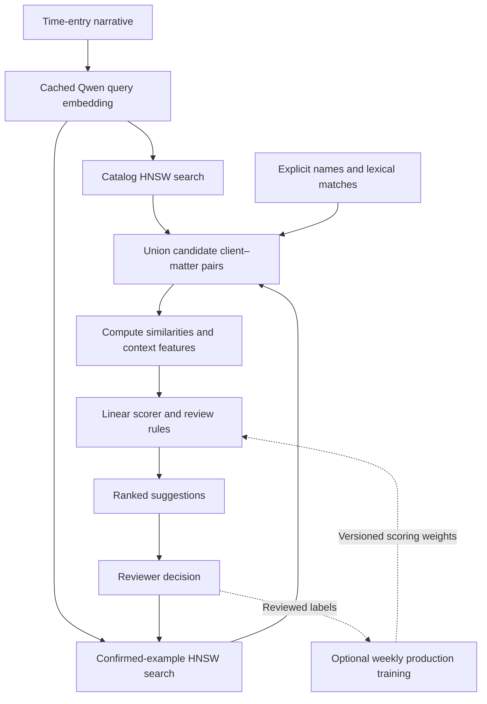

# PointTwo classification design

## Problem statement

PointTwo suggests the correct client–matter assignment for an existing time entry using its work narrative and a searchable client/matter catalog. **This is a multi-class classification problem:** each class is a client–matter pair. Nearest-neighbor similarities, explicit text matches, and timekeeper context are features in a shared linear ranking model.

For example, “Drafted term sheet for Series A round” should retrieve “Venture Financing – Series A” despite different wording. If several clients have equally plausible financing matters, the system should surface the ambiguity rather than invent a client identity.

This document covers classification requirements, retrieval, scoring, feedback, and the alternatives considered. See the [README](README.md#application-architecture) for the application architecture and setup.

## Requirements and design response

| Requirement | How the design addresses it |
| --- | --- |
| **Matching:** connect narrative paraphrases to relevant matters | Qwen embeddings capture semantic similarity; explicit client names and matter references add identity evidence. A linear scorer combines these features into ranked client–matter suggestions. |
| **Scale:** search 50,000+ client/matter records | Persist catalog and confirmed-example vectors in separate pgvector HNSW indexes. Retrieve bounded candidate sets before exact rescoring, rather than compare every record for every query. |
| **Reusable preparation:** store preparation and rebuild when data changes | Persist embeddings, text/model cache keys, indexes, source revisions, and preparation jobs. Reuse unchanged vectors; update changed records and support an explicit rebuild. Refreshing suggestions is separate from recomputing embeddings. |
| **Feedback:** accept or reject each suggestion and improve over time | Index accepted narratives as confirmed examples; corrections replace their associations and rejections exclude the applicable candidate. Future queries use this evidence. Production training can periodically learn scoring weights from reviewed labels. |
| **Low confidence:** signal weak matches | Apply evidence and top-two-margin review rules. Return explanations and a low-confidence state when evidence is insufficient; leave the assignment unresolved until review. Ranking scores are not probabilities. |

These are design mechanisms, not claims of measured accuracy. The [evaluation report](docs/EVALUATION_REPORT.md) separates matching quality, confidence coverage, feedback effects, and 50,000+ record search measurements, including limitations and unmet targets.

## Inputs and outputs

| Record | Fields |
| --- | --- |
| Time entry | `UserId`, `EntryId`, `Narrative`, `Hours`, `ClientName`, `MatterName`, `EntryDate` |
| Client/matter catalog | `ClientId`, `ClientName`, `MatterId`, `MatterName`, `MatterDescription`, `PracticeArea`, `MatterType`, `Status`; optional `RelatedKeywords` and `InvolvedTimekeepers` |
| Classification suggestion | `ClientName`, `MatterName`, `Score`, `Rationale`; return up to five ranked suggestions, with review status tracked separately |

Keep the **imported assignment**, **generated suggestions**, and **approved assignment** separate. Imported client/matter names may be wrong and are not training labels. Only confirmed assignments supply positive examples. `UserId` identifies the timekeeper; it does not grant access to a workspace.

Persist review decisions, source revisions, prepared embeddings, scorer versions, and immutable classification runs alongside the input records. These support audit history, stale-result detection, and reproducible debugging.

## Classification flow



Reviewer decisions update eligible evidence for later searches once preparation completes. Refreshing open suggestions reruns retrieval and scoring with cached embeddings. The dashed training path is a production extension: it would learn scoring weights from reviewed labels, while the demo keeps its weights fixed.

1. Retrieve catalog and confirmed-example neighbors separately. Initial candidate budgets are 50 catalog records and 100 examples, subject to evaluation.
2. Enforce workspace/timekeeper scope and compatible model/source revisions. Filtered HNSW may need iterative scans, partitioning, or exact search for small scopes.
3. Union candidate labels with lexical matches. Compute exact catalog similarity for every candidate, including those discovered through examples.
4. Deduplicate example narratives and retain each matter's strongest example similarity. Keep up to three supporting examples for explanations; do not sum their votes.
5. Score candidates, apply explicit decisions, and return up to five suggestions with explanations and review status.

**Without confirmed examples, search only the catalog.** Continue catalog retrieval as history grows so new matters remain discoverable. Exact rescoring improves candidate scores but cannot recover a matter omitted by retrieval.

## Embedding preparation

| Source | Embedded text |
| --- | --- |
| Catalog | `ClientName MatterName MatterDescription RelatedKeywords PracticeArea MatterType`, joined with spaces |
| New narrative | The query instruction below followed by the narrative |
| Confirmed example | Narrative as a document, without the query instruction |

```text
Instruct: Retrieve the client and matter matching this work description.
Query: <Narrative>
```

Keep IDs, hours, dates, status, and timekeeper involvement as structured metadata. Validate finite, nonzero 1,024-dimensional vectors and store float32 values in Postgres. Query/document formatting produces distinct cache entries.

Cache by model/preprocessing identity and exact input text. Persist vectors, source revisions, and indexes so unchanged data is not prepared again. This satisfies reusable dataset preparation; reranking open entries after feedback is a separate freshness operation and does not require rebuilding all embeddings. Version model weights, runtime, pooling, instructions, dimensions, and precision; never mix incompatible embedding spaces.

## Ranking and review

### Linear scoring model

Use the same feature weights for every candidate matter:

```text
score = bias
      + w_catalog   × catalog_similarity
      + w_example   × example_similarity
      + w_client    × client_name_match
      + w_reference × matter_reference_match
      + w_context   × timekeeper_involvement
```

| Feature | Definition |
| --- | --- |
| `catalog_similarity` | Exact cosine similarity to the candidate's catalog vector, clamped to [0, 1] |
| `example_similarity` | Maximum similarity to its retrieved confirmed examples, clamped to [0, 1]; 0 if none |
| `client_name_match` | 1 for an explicit client name match |
| `matter_reference_match` | 1 for an explicit matter identifier match |
| `timekeeper_involvement` | 1 if UserId appears in the matter's InvolvedTimekeepers |

Catalog preparation is required; absent optional evidence contributes zero. Example availability alone adds no score; only its measured similarity contributes. Availability may be retained as diagnostic context for review rules. A maximum avoids vote-count inflation, although larger histories still have more chances for a strong match.

Version features and weights together. Explanations show supporting records and `weight × feature` contributions. Scores express ranking, not calibrated confidence; production scores need not fall between 0 and 1.

### Demo scoring weights

Persist five seeded-random coefficients: catalog similarity 0.201625, example similarity 0.114333, client name 0.181672, matter reference 0.024534, and timekeeper context 0.254161 (rounded). Use zero bias; coefficients need not sum to one. Do not regenerate or renormalize them per query or feedback event. No separate coefficient rewards the mere presence of an example.

This reproducible random baseline demonstrates the flow, not optimized accuracy. Report its measured quality without selecting a favorable seed on test data.

### Review and immediate feedback

- **Accept:** retain the decision and index the narrative under the confirmed matter.
- **Correct:** supersede the old label, remove its positive association from eligible retrieval, and publish the corrected association.
- **Reject/undo:** exclude the applicable rejected candidate or remove the decision's effect.

Explicit decisions take precedence within their workspace/timekeeper, normalized-narrative, and compatible-revision scope. Track pending embedding updates so stale examples cannot influence retrieval. Feedback changes evidence immediately after preparation; it does not change Qwen or scoring weights, and never automatically reassigns reviewed entries. Saved suggestions are marked outdated. An explicit refresh queues outdated unapproved entries for background retrieval/ranking using their cached query vectors. Source revisions and evidence generations are rechecked before publishing results.

Choose score and top-two-margin thresholds on validation data for each scorer version. Until validated, demo scores remain uncalibrated and require review. Empty or ambiguous results stay unresolved. Closed matters remain available for historical review.

### Production scoring-model training

Train a shared **regularized logistic-regression scorer** on entry/candidate feature rows. Confirmed assignments are positives; reliably incorrect competing candidates are negatives. Rejection alone does not establish another candidate as correct. Imported assignments and unreviewed predictions are not labels.

| Stage | Procedure |
| --- | --- |
| Prepare labels | Use latest valid decisions with provenance and source revisions; deduplicate entries |
| Reconstruct features | Use only evidence available before each review; exclude the entry's own approved example and duplicate copies |
| Split | Earlier training data, later validation, and untouched later test data; prevent duplicate groups crossing splits |
| Train weekly | When enough new reliable labels exist, fit bias and feature weights using regularized binary cross-entropy; balance candidate counts and matter volumes |
| Evaluate | Compare against the random baseline and deployed scorer; check accuracy, abstention, latency, and new/sparse matters and languages |
| Release | Publish weights, feature processing, and thresholds only when quality gates pass; retain rollback, otherwise keep the deployed scorer |

Training can start from zero weights; production weights need not remain nonnegative or sum to one. Rank by the linear score. Sigmoid outputs require calibration before being presented as probabilities and do not sum to one across candidates.

Evaluate retrieval failures separately: do not insert the correct matter into evaluation candidates when retrieval missed it. Keep training and serving access scopes aligned; shared training across workspaces requires explicit authorization. Use fresh later evaluation windows rather than repeatedly tuning against one test set.

**Qwen stays frozen.** Weekly scorer updates require neither re-embedding nor an HNSW rebuild.

## Technology choices

### Language choice

Python keeps model integration, SQL access, training, and notebook evaluation together. Postgres performs vector search in native code.

| Option | Strength | Trade-off / role |
| --- | --- | --- |
| **Python** | NumPy, ML tooling, Postgres clients | Selected; interpreter and native dependencies to package |
| Rust | Memory and concurrency control | More work for model experiments |
| C++ | Direct native-library access | Unnecessary implementation complexity |
| TypeScript | Shared web UI tooling | UI option; weaker fit for this evaluation workflow |

### Database choice

Compare Postgres/pgvector with dedicated vector databases. **Postgres + pgvector is selected** because it combines relational review records and vector retrieval in one local or hosted service. Dedicated engines offer specialized search capabilities and independent scaling, but require another store to synchronize in our proposed architecture.

| Database | Search strengths | Deployment | Trade-off for PointTwo |
| --- | --- | --- | --- |
| **[Postgres + pgvector](https://github.com/pgvector/pgvector)** | HNSW/IVFFlat, exact search, SQL joins and filters | Local or hosted | One transactional store; tune filtered recall and shared database resources |
| [Qdrant](https://qdrant.tech/documentation/quickstart/) | Vector filtering and [quantization](https://qdrant.tech/documentation/manage-data/quantization/) | Local/self-hosted or managed | Candidate when vector-specific controls justify a separate service |
| [Weaviate](https://docs.weaviate.io/weaviate/concepts/search/hybrid-search) | Integrated vector and BM25 hybrid search | [Local/self-hosted](https://docs.weaviate.io/weaviate/quickstart/local) or managed | Built-in hybrid retrieval; additional data model and service to operate |
| [Milvus](https://milvus.io/docs/comparison.md) | Filtered/hybrid vector search and distributed deployment | [Lite, standalone, or distributed](https://milvus.io/docs/install-overview.md); managed via Zilliz | Deployment flexibility; distributed operations add complexity |
| [Pinecone](https://docs.pinecone.io/guides/get-started/overview) | Managed semantic, sparse-vector, and full-text search | Hosted service | Less search infrastructure to operate; network/provider dependency and usage costs |
| [turbopuffer](https://turbopuffer.com/docs/architecture) | [Vector/full-text retrieval](https://turbopuffer.com/docs/hybrid) backed by object storage and caches | Managed cloud or BYOC | Independent search scaling; service costs and cache-sensitive latency |

With a dedicated engine, retain Postgres for authoritative entries and review decisions; propagate versioned search updates/deletes and reject stale results. This is our architecture choice, not a claim that every vector database inherently requires Postgres. Compare filtered recall, latency, storage, and operational cost on the same workload before switching.

### Embedding model choice

**Qwen3-Embedding-0.6B** provides local inference, instruction-aware retrieval, multilingual coverage, and Apache-2.0 weights that permit later adaptation. Use 1,024 dimensions initially; smaller supported outputs require separate evaluation. [Qwen model card](https://huggingface.co/Qwen/Qwen3-Embedding-0.6B).

| Option | Strength | Trade-off |
| --- | --- | --- |
| **Qwen3-Embedding-0.6B** | Selected balance of local resources and retrieval capabilities | Model startup, memory, and domain quality need measurement |
| Jasper-Token-Compression-600M | English/Chinese; promising published results | 2,048 dimensions; token compression reduces sequence processing, not stored-vector dimensions |
| all-MiniLM-L6-v2 | Compact 384-dimensional embeddings | Evaluate legal-domain and language quality |
| Larger Qwen models | Potential quality gains | Higher resource use |
| Hosted embedding API | Managed inference | Network, privacy, cost, and customization constraints |
| Lexical search alone | Clear name/identifier matching | Misses paraphrases; retain as complementary evidence |

Model details: [Jasper](https://huggingface.co/infgrad/Jasper-Token-Compression-600M), [MiniLM](https://huggingface.co/sentence-transformers/all-MiniLM-L6-v2).

#### Benchmark evidence

Published reference results below are not PointTwo measurements or live leaderboard rankings. Compare like-for-like suites; dimensions and model configurations differ.

| Model | Reported suite | Mean (Task) | Retrieval |
| --- | --- | ---: | ---: |
| Qwen3-Embedding-0.6B | English v2, Qwen card | 70.70 | 61.83 |
| Qwen3-Embedding-4B | English v2, Qwen card | 74.60 | 68.46 |
| Jasper-Token-Compression-600M | English MTEB, Jasper report | 74.75 | 66.19 |
| Qwen3-Embedding-0.6B | Multilingual, Qwen card | 64.33 | 64.64 |
| Qwen3-Embedding-4B | Multilingual, Qwen card | 69.45 | 69.60 |

Sources: [Qwen evaluation](https://huggingface.co/Qwen/Qwen3-Embedding-0.6B#evaluation), [Jasper Tables 1 and 3](https://arxiv.org/html/2511.14405v2). Use [MTEB](https://huggingface.co/spaces/mteb/leaderboard) to shortlist models, then select using held-out client–matter accuracy, retrieval recall, latency, and memory. Benchmark scores do not establish legal-domain accuracy.

#### Multilingual support and adaptation

Qwen advertises 100+ languages; coverage does not guarantee equal quality. Test same-language, cross-language, and mixed-language narratives, legal terminology, name matching, truncation, and abstention per language. Preserve original text and use one compatible embedding space; translation is an alternative to evaluate.

Open-weight models can also be foundation models. The relevant choice is control over weights versus provider-managed access. Qwen permits optional contrastive fine-tuning on reviewed narrative/matter pairs and reliable hard negatives. This is separate from weekly scorer training: require held-out and multilingual gains, then re-embed documents and switch compatible encoders/indexes together with rollback. [Sentence Transformers training](https://sbert.net/docs/sentence_transformer/training_overview.html).

## Search alternatives

### Index choice

| Index | Preparation and search | Trade-off | Role |
| --- | --- | --- | --- |
| Exact SQL scan | Compare every eligible vector | Linear scan cost; exact reference | Ground truth and small scopes |
| **pgvector HNSW** | Build/search a neighbor graph | Graph storage; tune `m`, `ef_construction`, `ef_search` | Selected |
| pgvector IVFFlat | Train centroids; search selected lists | Cluster-pruning error; tune `lists`, `probes` | Comparison candidate |
| Faiss IVF-PQ | Train partitions and compressed codes | Smaller representation, added approximation error | Storage experiment |
| Faiss OPQ + IVF-PQ | Learn a transform before compression | Additional training and complexity | Deferred |
| Annoy | Build partition trees | Static index; more trees use more storage | Static-data alternative |

[pgvector](https://github.com/pgvector/pgvector) manages HNSW updates and persistence in Postgres. Use `ORDER BY embedding <=> query LIMIT k` with `vector_cosine_ops`; inspect `EXPLAIN` and filtered recall. [Faiss](https://github.com/facebookresearch/faiss/wiki/Faiss-indexes) offers broader offline index/compression experiments; [Annoy](https://github.com/spotify/annoy) cannot add items after index construction.

Other library alternatives include [hnswlib](https://github.com/nmslib/hnswlib) and [USearch](https://github.com/unum-cloud/usearch) for embedded graph search, [hnsw_rs](https://github.com/jean-pierreBoth/hnswlib-rs) for Rust, and [SQLite Vec1](https://www.sqlite.org/vec1.html) for SQLite-based compressed ANN. None is required alongside pgvector.

Per-matter centroids were considered for history compression, but a single average loses variation and individual supporting evidence. The design retains confirmed examples and searches them with HNSW; no clustering stage is required.

### Distance and similarity alternatives

| Measure | Preference | Magnitude sensitivity | Role |
| --- | --- | --- | --- |
| **Cosine similarity** | Higher | Removes vector norms | Selected semantic score |
| Cosine distance, `1 − cosine` | Lower | Removes norms | pgvector `<=>` search ordering |
| Inner product | Higher | Yes unless normalized | Equivalent ordering on unit vectors |
| Euclidean / squared L2 | Lower | Yes unless normalized | Equivalent exact ordering on unit vectors |
| Manhattan (L1) | Lower | Yes | No demonstrated benefit here |
| Hamming | Lower | Binary encoding | Future quantization experiment |

For unit vectors, `squared_L2 = 2 − 2 × cosine_similarity`; approximate indexes can still return different candidates. Match operators to index classes. Cosine is not a probability, and the notebook's 2D projection is not a search representation. [pgvector operators](https://github.com/pgvector/pgvector), [Faiss metrics](https://github.com/facebookresearch/faiss/wiki/MetricType-and-distances).

## Storage and lifecycle

Start with full-precision embeddings; no PQ/OPQ preprocessing is required. Approximate payloads for 50,000 × 1,024-dimensional vectors:

| Representation | Payload | Qualification |
| --- | ---: | --- |
| Float32, one copy | 195.3 MiB | Baseline |
| Float32 table plus full-precision index copy | 390.6 MiB | Excludes graph and database overhead |
| Float16, one copy | 97.7 MiB | Rounding changes distances |
| Int8 codes, one copy | 48.8 MiB | Quantizer/scaling metadata extra |
| PQ: 64 eight-bit codes per vector | 3.05 MiB | Illustrative; codebooks extra |

Reuse cached inference, deduplicate equivalent examples, and collect unreferenced vectors. If storage grows, evaluate pgvector half-precision or binary indexes while retaining float32 for rescoring. PQ/OPQ needs another backend; pgvector does not provide IVF-PQ. IVF partitions data, PQ compresses it, and OPQ learns a transform. [Faiss index factory](https://github.com/facebookresearch/faiss/wiki/The-index-factory).

Compressed indexes do not shrink retained originals. Measure total database/index storage and process/model memory separately.

Persist preparation jobs and record revisions. Publish asynchronously computed embeddings only when their source revision still matches. The user-triggered catalog rebuild also queues unapproved entries for background rescoring after preparation; accepted assignments and immutable run history remain intact. Rebuild indexes from saved vectors when index settings change; changing embedding models requires compatible re-embedding. Use transactional decisions, revision checks, backups, and index maintenance; rebuilds must not overwrite reviewed assignments.

## Evaluation

Use 50,000+ catalog records, varied history sizes, and duplicate-heavy examples. Keep embeddings, scopes, and scoring weights fixed when comparing indexes.

| Area | Measures |
| --- | --- |
| Retrieval | ANN recall@10/@30 against exact search; correct-matter candidate coverage |
| Assignment | Top-one/top-five accuracy, errors versus abstention, no-history/new-matter behavior |
| Learning | Random versus trained scorer on held-out later data; sparse matters and language breakdowns |
| Performance | First-query/warm p50/p95, embedding versus search time, build/update time, peak memory and total disk |
| Correctness | Accept/reject/undo, revisions, isolation, concurrent updates, interrupted preparation, restart recovery |

Proposed targets: recall@30 ≥ 0.95, warm retrieval/ranking p95 < 250 ms, warm end-to-end p95 < 3 seconds on documented hardware. These are targets, not measured results. Report quality alongside speed; process restart alone does not establish an OS cold-cache benchmark.

See the [evaluation report](docs/EVALUATION_REPORT.md) for measured results and the [README](README.md) for application architecture, setup, and review workflows.
