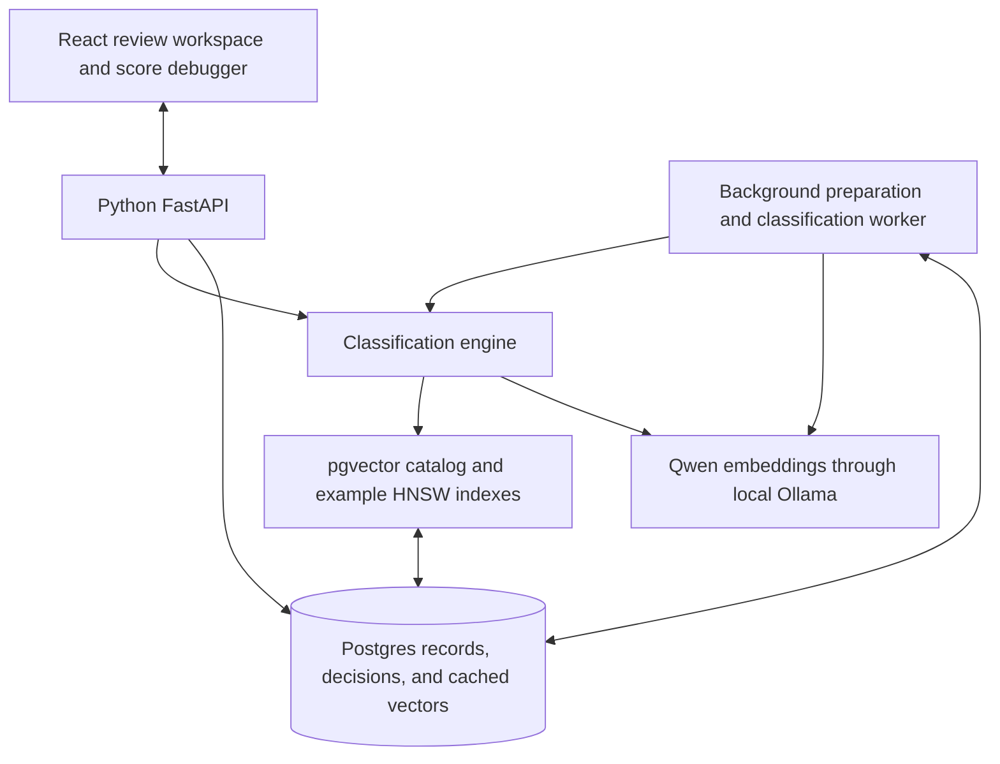

# PointTwo

A local client–matter classification and review application. Python ranks candidate labels using Qwen embeddings, Postgres/pgvector retrieval, explicit text matches, and timekeeper context. The React interface explains each score and shows how feedback changes future suggestions.

[Classification design and alternatives](DESIGN.md) · [Evaluation report](docs/EVALUATION_REPORT.md) · [Demo walkthrough](docs/DEMO.md)

## Overview

Import a client/matter catalog and existing time entries, prepare reusable embeddings, then review ranked assignment suggestions. Accepting or correcting an assignment supplies evidence for future classifications; rejecting a suggestion excludes the applicable candidate. Imported assignments, suggestions, and approved assignments remain separate.

The review workspace flags weak or ambiguous matches. The score debugger shows why a candidate ranked where it did and how feedback on another entry changes the result. The application runs locally with persistent storage and local embedding inference.

## Application architecture



The API handles imports, review decisions, and interactive classification/debug requests. The background worker prepares embeddings and classifies queued entries. Both paths use the same classification engine and persisted evidence. The optional Electron window wraps the web interface.

| Component | Choice and responsibility |
| --- | --- |
| Application | Python FastAPI and background worker: import, preparation, classification, and revision-checked review decisions |
| Storage/search | Postgres + pgvector: persistent records, workspace partitions, separate catalog/example HNSW indexes, and exact similarity calculations |
| Embeddings | Local Qwen3-Embedding-0.6B through Ollama, producing 1,024-dimensional vectors |
| Ranking | Five persisted seeded-random demo weights; a shared scorer trained on reviewed labels is the production extension |
| Interface | React review workspace and score debugger, available in a local browser or development Mac window |

The [classification design](DESIGN.md) explains candidate retrieval, feature scoring, confidence rules, feedback, and model/index alternatives.

## Run locally

Requirements: Python 3.12+, Node.js, a Postgres database with pgvector 0.8+ enabled, and local Ollama. The tested setup uses Postgres 17 and Qwen3-Embedding-0.6B with 1,024 dimensions.

Provide `DATABASE_URL` through your shell or private environment manager. It must identify a database whose application role can create the application tables and indexes. Have its administrator enable the `vector` extension before startup. Never commit a real connection string. Infrastructure provisioning is intentionally outside this repository; see [database notes](database/README.md).

```sh
python3.12 -m venv .pointtwo/classifier-venv
.pointtwo/classifier-venv/bin/python -m pip install -r classifier/requirements.txt
npm --prefix web ci
npm --prefix web run build
ollama pull qwen3-embedding:0.6b
# Start Ollama separately, and set DATABASE_URL privately before this command.
.pointtwo/classifier-venv/bin/python -m classifier
```

Open `http://127.0.0.1:8794`. The first run creates a private token in `.pointtwo/python/access-token`; use it to open the workspace. Startup applies the application schemas. The worker prepares catalog vectors and processes waiting entries after imports.

For the optional development Mac window:

```sh
npm --prefix desktop ci
npm --prefix desktop start
```

The window attaches to the running API and signs in locally. It can also start the API when `DATABASE_URL` and the Python environment are available. `POINTTWO_PYTHON` can override the Python executable path. A packaged standalone installer is not included.

| Setting | Default / purpose |
| --- | --- |
| `DATABASE_URL` | Required private Postgres connection string |
| `OLLAMA_URL` | `http://127.0.0.1:11434`; local endpoints only |
| `POINTTWO_DATA` | `.pointtwo/python`; token and API runtime data |
| `POINTTWO_WORKSPACE` | `local-review`; one authorized local workspace |
| `POINTTWO_PORT` | `8794`; keep this default for the desktop window and Vite proxy |

## Initialize test data

With `DATABASE_URL` configured privately, run:

```sh
.pointtwo/classifier-venv/bin/python -m classifier.seed
```

This imports 114 fictional matters and 562 entries (the small starter set plus the evaluation corpus) into `POINTTWO_WORKSPACE`, defaulting to `local-review`. Existing IDs are skipped, including edited records and accepted assignments. Expected labels are not imported as feedback. Start the application to prepare vectors and classify queued entries. Use `--small` for just six matters/six entries, or `--workspace demo` to select a separate workspace; launch the API with that same `POINTTWO_WORKSPACE`.

## Review and debug

1. Import [catalog.json](fixtures/catalog.json) and wait for preparation. Unchanged text reuses persisted embeddings.
2. Import [time-entries.json](fixtures/time-entries.json). Each entry preserves the seven prompt fields, including its potentially incorrect original assignment.
3. Compare assignments with ranked alternatives; accept, reject, correct, or undo.
4. Choose **Open debugger** directly from a time-entry row, **Open in score debugger** in its detail view, or search the exact EntryId inside **Score debugger**. Select a candidate to inspect feature values, weights, and contributions.
5. Save a probe baseline. The embedding graph shows the entry, matter descriptions, and retrieved confirmed examples. Select a point for exact cosine distance.
6. Use **Correct another entry** to assign a different narrative for the same timekeeper and reevaluate the fixed probe. Compare graph and score changes, then restore the previous assignment or keep it and add more feedback.

The debugger exposes supporting neighbors, feature values, weights, contributions, and review reasons. It compares a fixed probe before and after feedback on another entry. Its 2D embedding projection is illustrative; displayed cosine similarities use the full vectors. Immutable debugger runs and saved entry suggestions can reflect different evidence versions until suggestions are refreshed.

The **Imported assignment** column shows the input `ClientName` and `MatterName`; empty fields display Unassigned. Approved assignments are displayed separately in entry details.

Corrections update retrieval evidence and mark prior results outdated. They do not automatically rerun every open entry. **Refresh open suggestions** queues outdated/failed unapproved entries for background search and scoring, reusing cached query embeddings and catalog indexes. Accepted assignments are preserved; the debugger’s saved baselines remain immutable.

**Rebuild & refresh scores** rebuilds catalog preparation and queues every unapproved entry for rescoring, including failed entries. It reuses unchanged embeddings.

The demo uses fixed seeded-random weights. Confirmed examples contribute through cosine similarity; there is no example-availability bonus. Scores are not probabilities. Imported assignments, suggestions, and approved assignments remain separate. The conservative confidence policy is uncalibrated and all suggestions require review. UserId scopes timekeeper evidence; it is not authentication.

## Evaluation and tests

The [synthetic corpus](fixtures/classification-corpus.json) contains 108 fictional matters and 556 entries covering clear matches, genuine ambiguity, typos, multiple languages, and feedback probes. Expected labels never enter the classifier. Use the seed command to import the corpus. Evaluation results and their interpretation belong in the [evaluation report](docs/EVALUATION_REPORT.md).

With `DATABASE_URL` configured:

```sh
.pointtwo/classifier-venv/bin/python -m pip install -r classifier/requirements-dev.txt
.pointtwo/classifier-venv/bin/python -m pytest tests
npm --prefix web run build
# Real-Qwen quality evaluation in a new isolated workspace:
.pointtwo/classifier-venv/bin/python -m classifier.evaluate
# ANN recall against exact search on the prepared catalog you select:
.pointtwo/classifier-venv/bin/python -m classifier.benchmark --workspace local-review
```

Tests use isolated workspaces and deterministic vectors. Quality evaluation uses real Qwen and writes `.pointtwo/python/evaluation.json`; it retains its workspace for inspection. The benchmark writes `.pointtwo/python/benchmark.json`, reports the actual record count and query plans, and does not generate a 50k catalog. Small catalogs may use exact search. The [report](docs/EVALUATION_REPORT.md) distinguishes historical 50,100-vector measurements from small-catalog accuracy.

`python tests/generate_corpus.py` regenerates the synthetic fixture. Offline scorer training is available through `python -m classifier.train --workspace local-review`; it writes candidate weights and never deploys them automatically.

## Local execution and central-server deployment

| Concern | Local demo | Central service |
| --- | --- | --- |
| Application | Local Python | Authenticated Python API and workers |
| Records and retrieval | Local Postgres + pgvector | Server-hosted Postgres + pgvector |
| Embeddings | Local Qwen | Shared inference or explicitly supported compatible device vectors |
| Access | One local workspace | Authorized users/devices; scoped feedback |
| Operations | Local service, persistence, backups | Backups, monitoring, capacity, recovery |

The demo is persistent, not purely in-memory; 50,000 records is an evaluation target, not a capacity limit. Central deployment requires explicit data-sharing opt-in. A central service would need an authenticated API with idempotent writes, revisions, incremental changes, and conflict handling. Database hosting alone does not provide synchronization; offline edits need a separate queue/conflict protocol. Imported UserId is metadata, not authorization.

## API and repository

`POST /api/classify` accepts one prompt-shaped entry and returns `ClassificationSuggestion[]` with `ClientName`, `MatterName`, `Score`, and `Rationale`. Response headers include the review flag and debug run ID. All review/debug endpoints require the local bearer token.

| Endpoint | Purpose |
| --- | --- |
| `/api/catalog`, `/api/preparation` | Import catalog and inspect preparation |
| `/api/time-entries` | Import/list entries |
| `/api/time-entries?entry_id={EntryId}` | Exact lookup by imported time-entry ID |
| `/api/time-entries/{id}/debug` | Fresh debug snapshot with the entry’s actual metadata |
| `/api/time-entries/refresh-open` | Queue outdated/failed unapproved entries |
| `/api/time-entries/{id}/decisions` | Revision-checked accept/reject/undo/retry |
| `/api/debug/classify` | Save a score/evidence snapshot |
| `/api/debug/runs/{id}/projection?after={runId}` | Fixed-axis graph and full-dimensional cosine distances |
| `/api/debug/runs/{id}/compare` | Compare a baseline with current evidence |

[Python module map](classifier/README.md) · [Database schema](database/README.md) · [Embedding notebook](notebooks/README.md)

Infrastructure, credentials, local databases, model files, generated reports, and the assignment PDF are excluded from version control. The application listens on loopback and has a single local token/workspace boundary; central deployment needs a separate authorization and data-sharing design.
