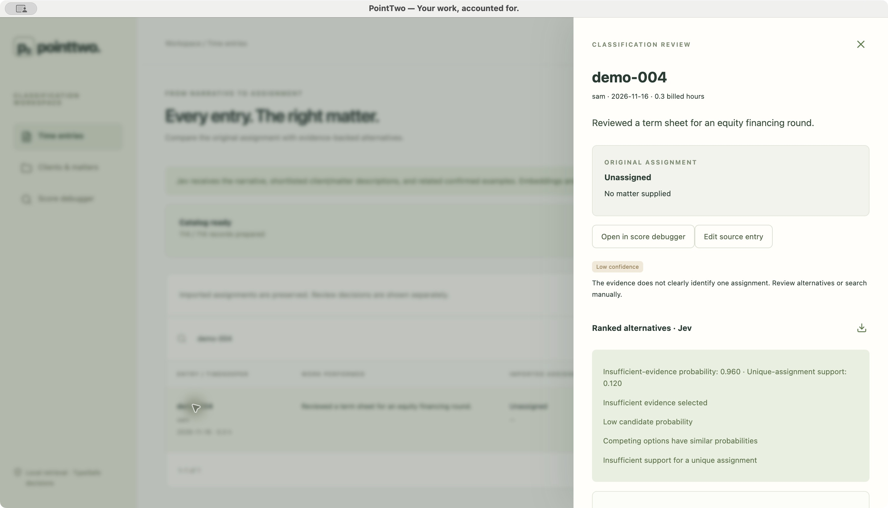
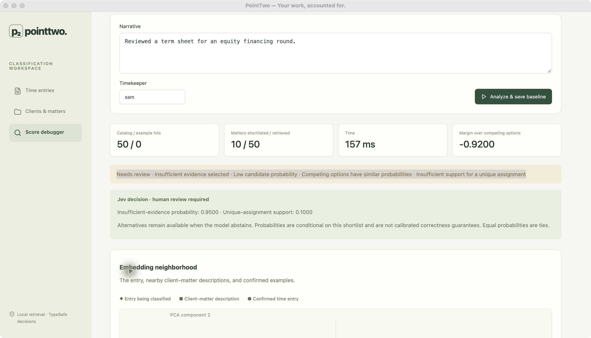
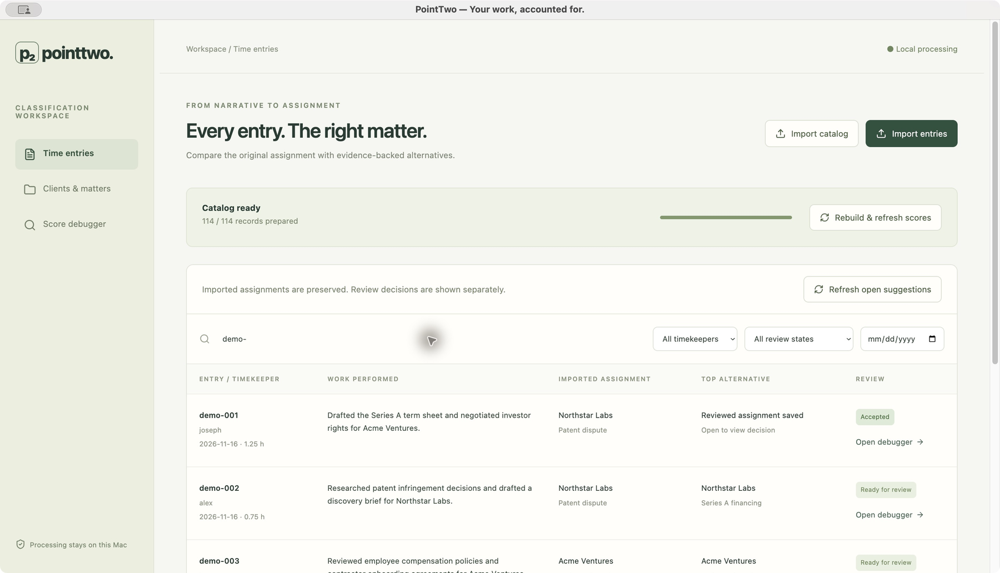
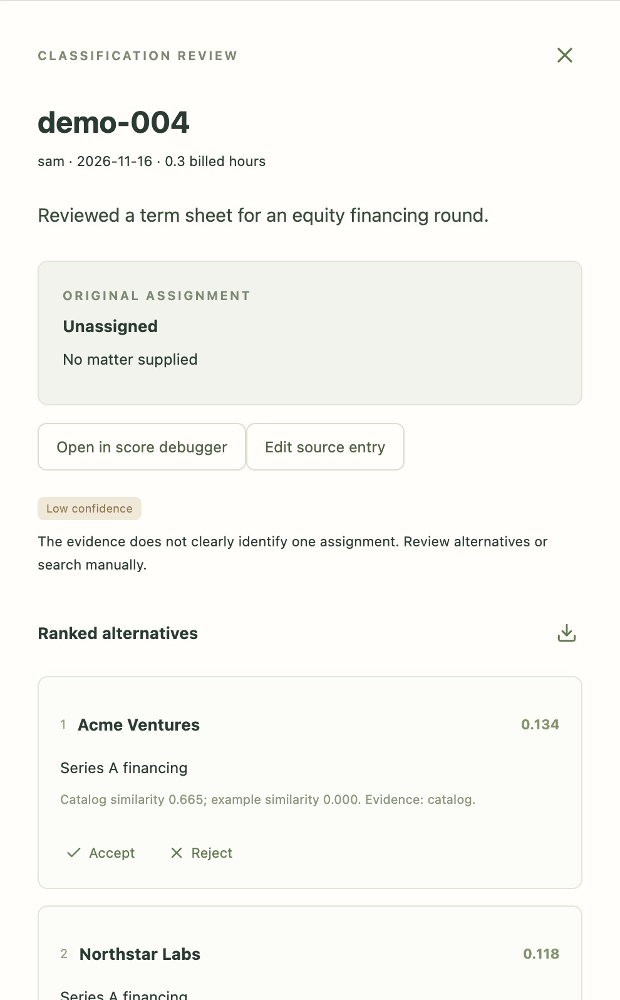
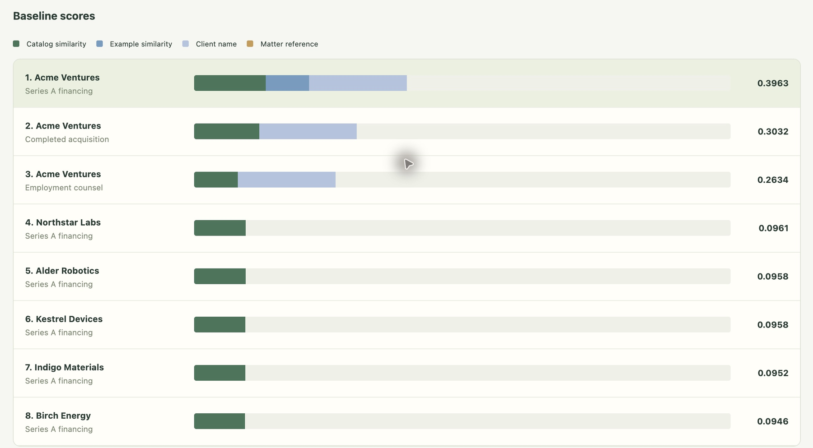
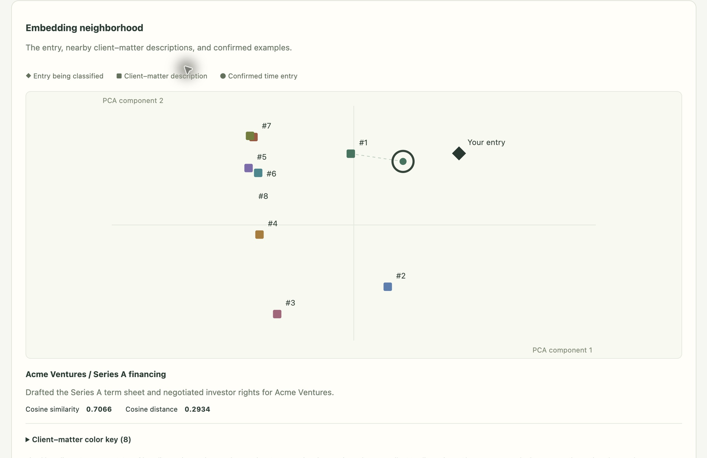

# PointTwo demonstration

Start the application using the [README](../README.md#run-locally), then open `http://127.0.0.1:8794` or run `npm --prefix desktop start`. With the same private database/workspace configuration, run `python -m classifier.seed` to import the fictional demo data. Existing IDs and review decisions are preserved.

The Jev configuration displays option probabilities and an evidence-sufficiency check, while retaining alternatives when uncertain. The new Jev captures below show the hosted decision path. Later weighted-baseline captures are historical.

These screenshots were captured from the running application with synthetic records and existing review history. Scores and review states can differ in a newly seeded workspace. Screenshots are cropped or resized for readability.

## Jev review and debugger

With Jev enabled, `demo-004` retained five alternatives while choosing insufficient evidence. This saved review run returned **0.96** for insufficient evidence and **0.12** for unique-assignment support; Acme and Northstar financing remained selectable at **0.03** and **0.01**. The entry stayed unassigned.

Open the entry in the debugger to inspect option probabilities, review thresholds, API timing, and the exact model request/response. Select a candidate to see its catalog description and confirmed narratives. A separately recomputed run returned **0.95** for insufficient evidence and **0.10** support; these are separate immutable runs, and hosted responses can vary.

## Earlier weighted-baseline captures

## Review assignments

Search Time entries for `demo-`. Open `demo-001`: its imported assignment is Northstar Labs / Patent dispute, while its narrative describes Acme's financing work. Compare the imported assignment, suggestions, and approved assignment separately. In this capture, the entry already has an accepted decision.

## Handle ambiguity

Open `demo-004`: “Reviewed a term sheet for an equity financing round.” Several clients have financing matters, but the narrative names no client. The application shows alternatives and a **Low confidence** warning; it leaves the entry unassigned until review. Each suggestion offers **Accept** and **Reject**, and the reviewer can search the full catalog for a different matter.

## Inspect a weighted-baseline score (historical)

Choose **Open in score debugger** from entry details, **Open debugger** on a row, or search an exact EntryId in the debugger. In Jev mode, select a candidate to inspect its probability, catalog text, and the exact confirmed narratives supplied to the model. Saved weighted runs retain their feature values, weights, and contribution bars.

For the captured example, use timekeeper `joseph` and analyze this exploratory probe:

> Revised investor rights provisions and financing documents for Acme Ventures.

With `demo-001` already confirmed as Acme / Series A financing, the probe retrieves that distinct narrative as supporting evidence. The resulting Acme score is **0.3963**: approximately 0.1338 catalog similarity contribution + 0.0808 example similarity contribution + 0.1817 client-name contribution (rounded). Neither example availability nor catalog timekeeper involvement adds a bonus. These are ranking scores, not probabilities.

## Explore the embedding neighborhood

Click a point in the graph to inspect its full-dimensional cosine similarity and distance. The diamond is the probe, squares are catalog descriptions, and circles are confirmed narratives. Here, the selected confirmed Acme narrative has cosine similarity **0.7066** to the probe.

The map is a 2D PCA approximation; the displayed cosine values use all 1,024 dimensions. Lines connect confirmed examples to their matters, not HNSW neighbors. The graph keeps baseline axes fixed when comparing feedback. This capture shows existing feedback evidence, not a measured before/after experiment.

## Try a feedback experiment

1. Enter a narrative and timekeeper, then choose **Analyze & save baseline**. The saved run is immutable.
2. In **Correct another entry**, select a different source narrative for the same timekeeper and its correct matter. Choose **Apply correction & reevaluate probe**. This saves a real, reversible review decision.
3. Compare the baseline and feedback graph, option probabilities, and supplied examples. The probe's assignment and model weights stay unchanged; an identical normalized narrative can separately trigger an explicit decision override.
4. Choose **Restore previous assignment & reevaluate** to undo the experiment, or retain the correction. Change the probe's timekeeper to check that confirmed history is scoped separately.

After feedback, **Refresh open suggestions** queues outdated unapproved entries; accepted assignments stay fixed. **Rebuild & refresh scores** also rebuilds catalog preparation while reusing unchanged embeddings.

## Evaluate the result

Explore the synthetic corpus's same-client matters, missing client names, conflicting references, unknown clients, and unrelated work. A plausible nearest neighbor does not establish a unique assignment.

The [evaluation report](EVALUATION_REPORT.md) records measured accuracy, feedback effects, performance, and limitations in an isolated workspace. Compare top-one/top-five accuracy with abstention and ready-for-review coverage: good ranking does not establish calibrated confidence. Expected labels are evaluation data and never classifier inputs.
